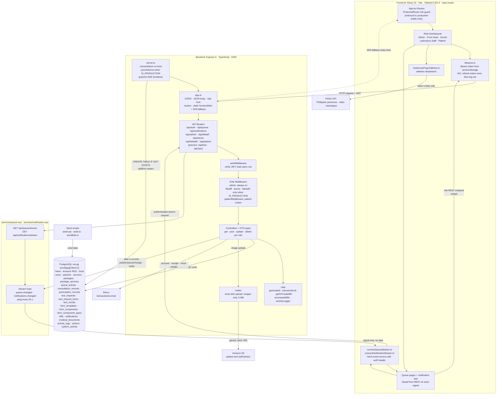

<h1 align="center">TechCare: Cloud-Based Integrated Clinic Information System</h1>

  

  
    
  
  
  
  

  <a href="https://www.techcare-system.com/">
    <strong>Live Application</strong>
  </a>
  ·
  <a href="docs/SETUP.md">
    <strong>Setup Documentation</strong>
  </a>

---

TechCare is a full-stack clinic management system designed to streamline patient registration, consultation and laboratory queueing, laboratory requests, billing, and administrative operations for Reyna G. Diagnostic Medical Clinic.

## Features by Role

| Role | What they do |
|---|---|
| **Admin** | Users and roles, services, packages and pricing, laboratory form templates, activity log, sales and service reports, live queue monitor |
| **Front Desk** | Patient registration and records, consultation and laboratory requests, billing and payment confirmation, queues |
| **Doctor** | Consultation queue, active consultation (findings, prescriptions, the patient's medical history), test requests (laboratory, imaging, packages) |
| **Laboratory Staff** | Laboratory queue per room, specimen collection, result entry from form templates, result release |
| **Patient** | Dashboard, queue tracking, laboratory results, medical history, prescriptions |

### Patient registration

- **Address:** Province → City/Municipality → Barangay are dropdowns filled from the public [PSGC API](https://psgc.gitlab.io/api/) (Philippine Standard Geographic Code). Only place codes are sent to it, never patient data. If it can't be reached, the fields become plain text inputs. Street and ZIP code are typed.
- **Blood type:** includes **N/A** for patients who don't know theirs.
- **Email:** optional; unique when given.
- **Login password**, chosen by the front desk:
  - **Set the password now:** the patient can log in right away. If they have an email, it is sent to them with their username.
  - **Email a link:** the patient creates their own password from a one-time link (7 days). Needs an email.

### Email (Brevo)

Account created (staff and patients), payment receipt, and lab result ready. Links use `APP_URL`, which must be the frontend address in production. See [docs/EMAIL.md](docs/EMAIL.md).

## Group Members

- Dela Cruz, Marc Jodel
- De Guzman, Mike Cleo
- Geronga, Laurence Anthony
- Juan, Randy Jr.
- Matangob, Jiano Freo

## System Architecture

The diagram below reflects the code as it exists today: the React role dashboards, the Express 5 API with its JWT and role middleware, the role routers, the two SSE streams (live queue and notifications), the PostgreSQL schema, and the external services.

## Project Rules

- **Each role calls only its own API.** A role's frontend (`frontend/src/users/<role>/`) only calls its own prefix: doctor → `/api/doctor`, front desk → `/api/fdstaff`, laboratory → `/api/labstaff`, admin → `/api/admin`, patient → `/api/patient`. Shared by all logged-in users: `/api/auth`, `/api/notifications`, `/api/queue/stream`. If a screen needs data that only another role's endpoint has, add a new endpoint to its own router (for example `POST /api/doctor/test-requests`). Other roles' routers are role-protected, and a wrong-role 401 logs the user out.
- **Driver-portable SQL.** `config/pgClient.ts` is a small `sql` tagged template over `pg`. Keep queries to plain parameters so they also work with the Neon driver. For optional filters use `AND (${x || null}::text IS NULL OR col = ${x || null}::text)` instead of nesting `sql` fragments.
- **Folder layout per role:** `<Role>.tsx` shell, `pages/<Page>.tsx`, `components/<Page>/`, with child-only components in a `Parent/` folder next to `Parent.tsx`.

## Documentation

| Document | Covers |
|---|---|
| [docs/SETUP.md](docs/SETUP.md) | Environment variables, deployment scenarios, seeding, troubleshooting |
| [docs/EMAIL.md](docs/EMAIL.md) · [docs/EMAIL_FLOW.md](docs/EMAIL_FLOW.md) | Brevo setup, `APP_URL`, which emails are sent and when |
| [docs/AWS_SETUP.md](docs/AWS_SETUP.md) | AWS setup: RDS database and S3 image uploads |
| [docs/AWS_SERVER.md](docs/AWS_SERVER.md) | Running the server on AWS EC2 (vs Render) |
| [docs/AWS_MANAGE.md](docs/AWS_MANAGE.md) | Managing the RDS database and S3 photos |
| [docs/RELEASE_INTEGRATION.md](docs/RELEASE_INTEGRATION.md) | Release integration for the billing branch |
