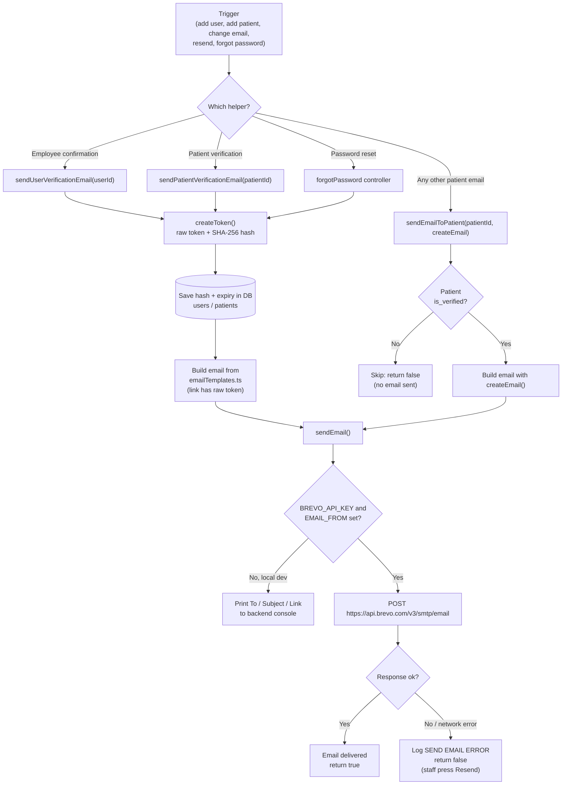
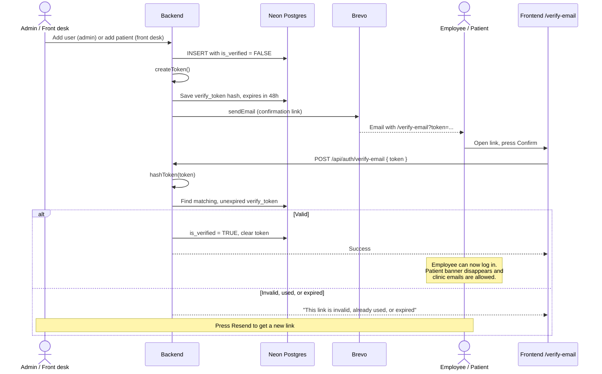
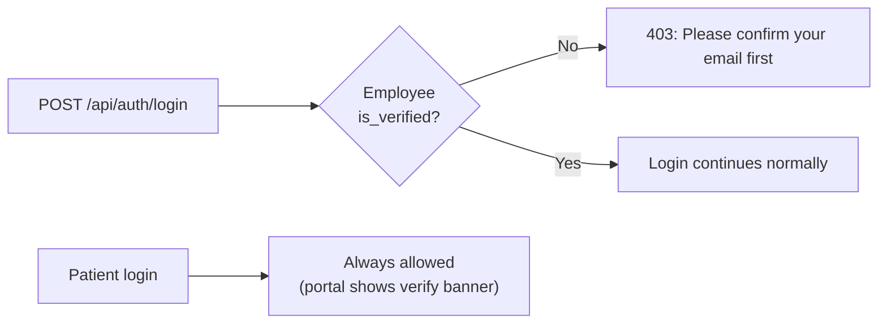
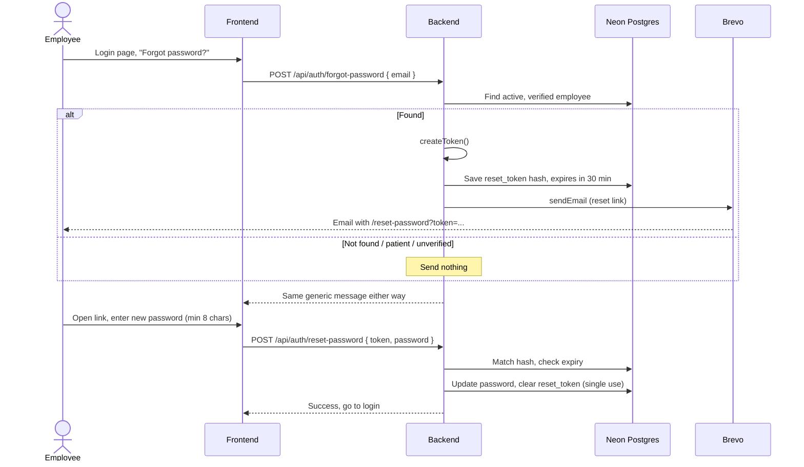
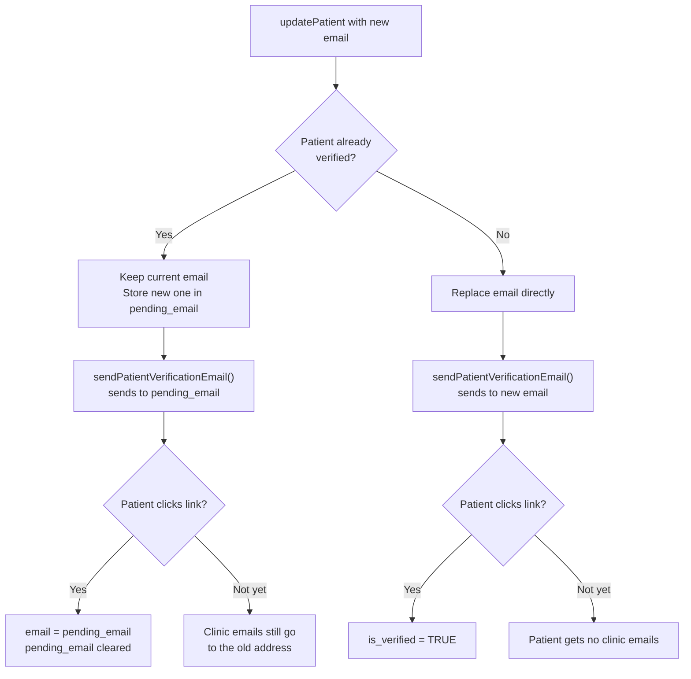
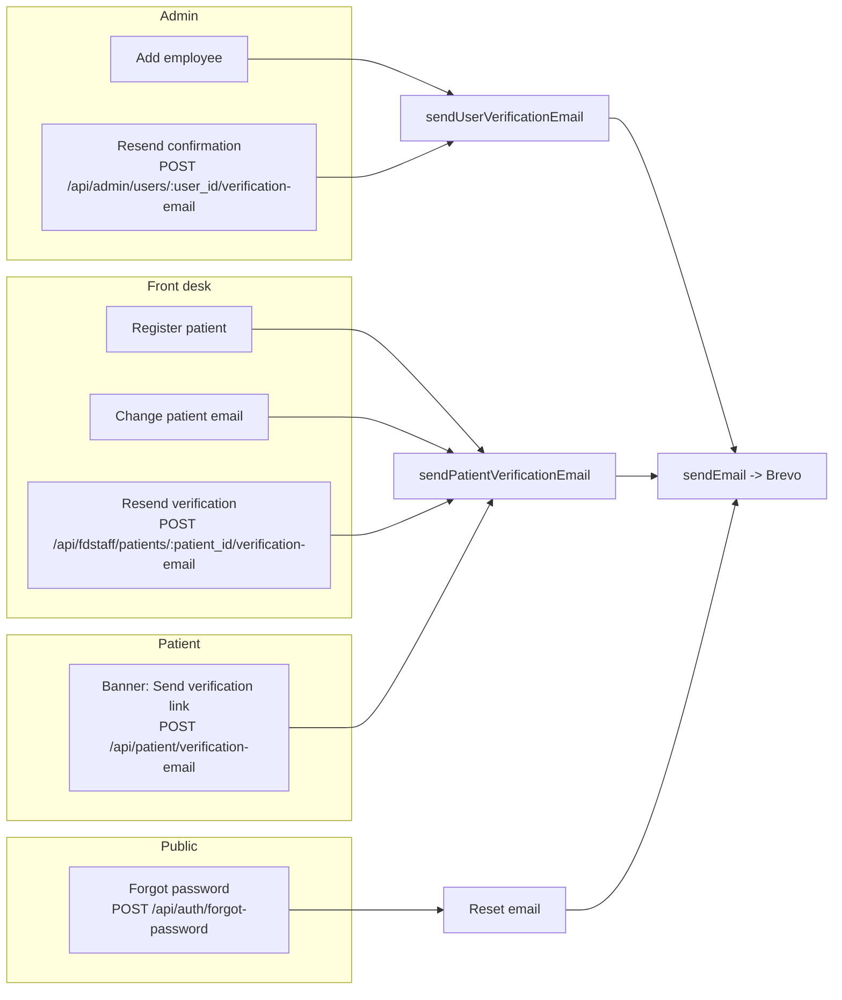

# Email Flow Diagrams

Diagrams of how TechCare sends emails. For the full written guide, see [EMAIL.md](EMAIL.md).

## 1. Overview: how every email is sent

## 2. Email verification (employees and patients)

## 3. Employee login before verification

## 4. Forgot password (employees only)

## 5. Front desk changes a patient's email

## 6. Who can trigger an email

